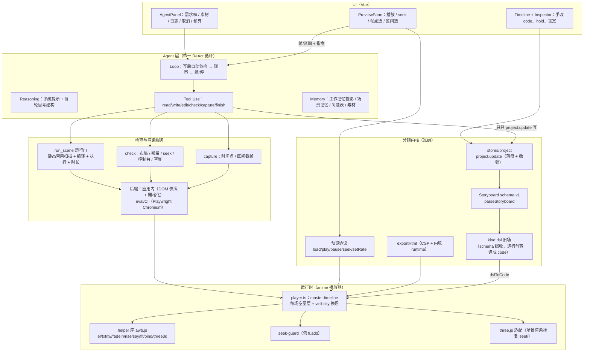
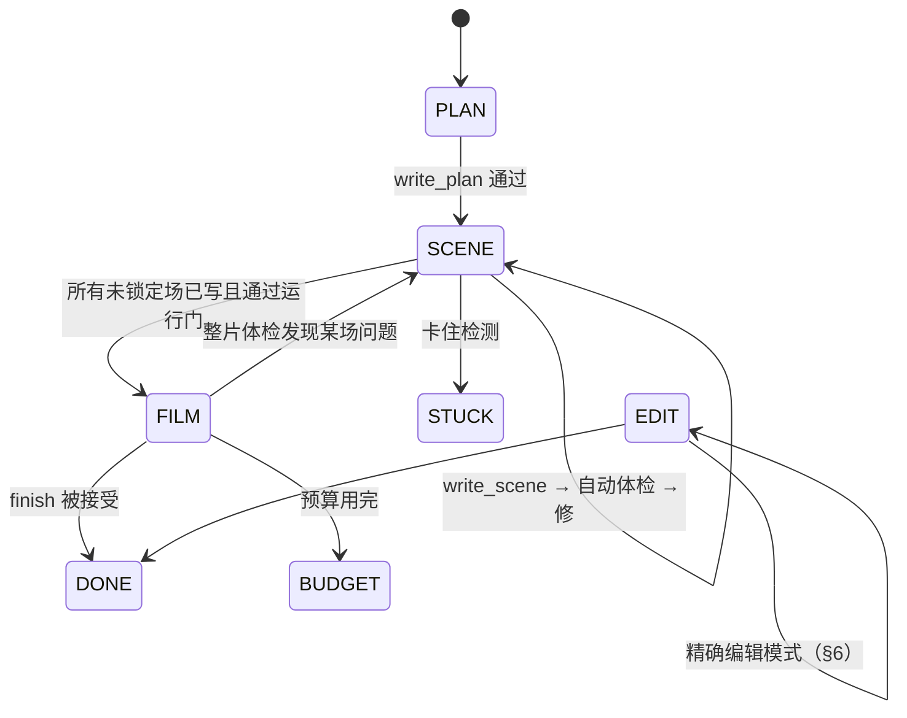

# animation-workbench v2 设计书：软件 + harness agent

版本 2026-11-09（太平洋时间），当晚 22:34 修订：DSL 内核的 manim-web 一并删除，three.js 钉 0.187.0，预算初值已定。配套复盘：`01-postmortem.md`。基线分支 `feat/agentic-codegen`（PR #12 合入后的树；S8d 原型改动只在实验拷贝里，没进仓库）。

这份文档写给执行改码的 agent（包括 Cursor Auto 模式）。按 §10 的 PR 顺序一次做一个。每个 PR 开工前先读本文的 §0、对应小节和 `AGENTS.md`。

---

## 0. 给执行 agent 的总规则

1. **一次只做一个 PR**，范围以 §10 为准。做不完就缩小范围，不要顺手改别的。
2. **只开 PR，不合并。** base 用 `feat/agentic-codegen`。
3. **内核黑名单不碰**（§3）。唯一例外是 §3.1 里标「解冻」的 manim-web 渲染依赖，只在 PR-9b、PR-9c 里动。其余要碰就停下，在 PR 描述里写明原因，等人决定。
4. **能删就删，不叠开关。** 新逻辑替换旧逻辑时，旧逻辑在同一个 PR 或紧接着的下一个 PR 里删掉。不留「兼容层」「旧路径备用」「默认关的新路径」。
5. **新增明显多于删除时**（经验线：新增 > 删除 × 3 且新增 > 300 行），PR 描述里要单列一节「为什么新增多」，说明新增的每个文件是干什么的。
6. PR 正文固定五节：**做了什么 / 删了什么 / 没碰什么 / 对应审计项（36 条里的编号，或本文 §编号）/ 必跑测试**。
7. 必跑：`pnpm check`、`pnpm test:e2e`（至少 `m1`、`m2`、`m4-export`、`anime-renderer`）、三平台 CI 绿；勾股示例场景起止 `[0,4.5]`、`[4.5,10]`、`[10,17]` 不变。
8. 不确定的 API（尤其 three.js、DeepSeek 的工具调用细节）先写最小测试验证，再写实现。测试过不了就在 PR 里如实说明，不要绕过。

---

## 1. 目标与验收

### 1.1 目标

用户用自然语言说要讲什么、怎么改；agent 写出可 seek 的 HTML/SVG（anime.js）或 WebGL（three.js）时间线，写回分镜 `scenes[]`。用户随时能在时间线、检查器、预览里精确改一场、锁定、导出。

### 1.2 验收（三条都要过）

| # | 验收 | 怎么判 |
|---|---|---|
| G1 | **质量**：同一道题，软件 + DeepSeek 生成的视频不能差过手写 | 五题（§11）机器初筛全过（与手写同一套标准），再由你看完整视频终审。手写对照是 `awb-s8c/hand-anime/`，五题手写在这套标准下 5/5 PASS。 |
| G2 | **分镜精确编辑不能被冲掉** | 锁定场字节不变；手改一场的 `code` 或 `hold` 后，再跑 agent（生成或精确编辑），未点名的场 `code` 字节不变、整片帧像素不变；预览 seek 正确；撤销一步能回到 agent 改之前。 |
| G3 | **代码整洁** | 删除清单（§9）全部落地；`src/ai/agent/` 只有一套循环、一套工具协议；设置里与生成相关的开关只剩 `generation.engine`（合 main 前），合 main 后为零；没有死代码（`eslint` 未用导出检查 + 人工审 diff）。 |

### 1.3 非目标

- 不为 agent 专门做 LaTeX 能力。KaTeX 只因 DSL 的 `MathTex` 兼容而进运行时（§4.7）；`tex()` helper 会在速查表里出现，agent 可以用，但系统提示不主动推荐，S8d 五题的文字排版公式够用。
- 不做多模型分阶段路由（审计 #27、#28 保持暂不修）。
- 不改 legacy DSL 的生成提示词（legacy 生成管线在 PR-13 整体删除）。

---

## 2. 总体架构



数据流只有一条：**agent 的所有写入都经工具 → `project.update`**；预览、导出、检查都只读分镜。

---

## 3. 分镜内核（冻结）

### 3.1 内核黑名单（不改语义，只许旁路）

| 模块 | 路径 | 规则 |
|---|---|---|
| schema v1 / `parseStoryboard` | `src/shared/schema.ts` | 不升版本、不加必填字段。agent 状态放 `.awb/anim/`，不进 `storyboard.json`。 |
| 落盘与撤销 | `src/stores/project.ts` | `project.update` 是唯一写入口。agent 一次工具写入 = 一次 `update` = 一步撤销。 |
| 预览协议 | `src/shared/protocol.ts` | `load/play/pause/seek/setRate` 语义不变；需要新能力加新消息类型。**解冻**：`ready` 消息里的 `manimWebVersion` 字段删除（PR-9c），其余字段不动。 |
| DSL 渲染 | `src/runtime/interpret.ts`、`builders.ts`、`index.ts` | **解冻并删除**（2026-11-09 用户决定）。改为运行时把 `kind:'dsl'` 转译成代码场（§4.7）。DSL 的**数据格式**仍冻结：schema、`registry.ts`（schema 依赖它）、`timing.ts` 的时长算法都不改。 |
| 导出 | `src/features/export/exportHtml.ts` 的 `assembleExportHtml` | CSP 指令与内联结构不改。**解冻的只有内联的运行时包**：从 manim 的 `runtime.js` 换成 anime 运行时（PR-9c），因此「纯 DSL 项目导出逐字节不变」这条作废，改为「CSP 模板不变 + 导出页能播、场景起止时间不变」。 |
| 金标准 | `samples/pythagoras/**` | `storyboard.json` 文件只读、不改写（它就是「旧 DSL 项目」的代表）。**解冻**的是它的渲染：改由转译器播放。场景起止 `[0,4.5]`、`[4.5,10]`、`[10,17]` 仍是硬回归。 |
| 边界 lint | `tests/lint-boundaries.test.ts` | 保留 platform / shared 规则。「只有 `src/runtime` 能依赖 manim-web」改成「只有 `src/runtime` 能依赖 `animejs`、`three`、`katex`」（PR-9c）；新增「`src/ai/agent` 不能 import 这三个」。 |

### 3.2 分镜字段在 v2 里的用法

| 字段 | 谁写 | 说明 |
|---|---|---|
| `scenes[].id/title/description/hold/enter` | `write_plan`；用户在检查器 | `hold` 秒，0–30（`apply.ts` `clampHold`）。 |
| `scenes[].kind` | agent 只写 `'code'` | 旧项目里的 `'dsl'` 照常解析、照常播放（转译），agent 改写 dsl 场时整场写成 `'code'`。 |
| `scenes[].code` | `write_scene` / `edit_range` / 用户手改 | 只放**本场代码 + 项目共享常量块**（§4.3），不再放 helper 库。 |
| `scenes[].locked` | 只有用户 | agent 所有写工具遇到 locked 一律拒绝。 |

---

## 4. 运行时

### 4.1 渲染栈

| 库 | 版本 | 许可证 | 用途 |
|---|---|---|---|
| anime.js | `4.5.0`（已钉死） | MIT | 所有时间线。场景函数签名不变：`async (root, anime, tl, ctx) => {}`。 |
| three.js | 钉 `0.187.0`（已定；npm 上标 MIT，2026-11-09 查） | MIT | 3D 场（祖暅立体、线代 3D 变换等）。由运行时按需提供，不让场景 import。 |
| GSAP | — | 禁用 | `check-licenses.mjs` 继续禁止。 |
| KaTeX | 钉 `0.19.1`（npm `latest`，标 MIT，2026-11-09 查；现在作为 manim-web 的传递依赖已在树里） | MIT | 只为 DSL `MathTex` 兼容。字体 woff2 共 20 个约 296KB，以 data: URI 内联（导出 CSP 已允许 `font-src data:`）。 |
| manim-web | 0.40.1 → **删除** | MIT | 代码场（PR-9a）和 DSL 内核（PR-9c）全部裁掉，`package.json` 和 lockfile 里不再出现。 |

### 4.2 helper 库 `awb.js`（运行时内置，不进场景代码）

位置：`src/runtime/anime/awb.ts`（导出一段源码字符串 + 类型说明），由 `player.ts` 编译场景时注入。来源是 S8d 的 `prompts/helpers.js`（从手写 `shared.js` 抽出来的那份），**只合并 `seek-guard.js`，补 `bind`、`three3d`、`tex` 三个**；DSL 转译需要的形状和动画函数放在单独的 `dsl-lib`（§4.7），不进 agent 的速查表。

**注入方式**（解决复盘 D4「已声明」问题，同时兼容已经把 helper 烘进 `code` 的旧项目）：

```js
// player.ts 编译时实际执行的函数体
/* awb.js helper 源码（const W, C, el, tw, ...） */
{
  /* scene.code 原文：块作用域里再写 const W 只会遮蔽，不会报错 */
}
```

#### 常量

| 名字 | 值 |
|---|---|
| `W`, `H` | 1920, 1080 |
| `C` | `{ blue, green, orange, red, yellow, purple, teal, text, soft, dim, bg }`（手写那份配色） |
| `NS` | SVG 命名空间 |
| `MONO` | 等宽字体栈 |

#### 搭元素（建场时调用一次，与时间无关）

| 签名 | 语义 |
|---|---|
| `el(tag, style?, html?, parent?) → HTMLElement` | 建 `position:absolute` 元素，数字样式自动补 px，默认挂到 `root`。 |
| `txt(html, x, y, size, color?, extra?)` | 单行字（`nowrap`）。 |
| `ctext(html, y, size, color?, extra?)` | 整行居中字，左右各留 48px。 |
| `svgRoot(parent?) → SVGSVGElement` | 满屏 SVG，`viewBox 0 0 1920 1080`。打 `data-awb-role="canvas"`，布局检查不把它算出界。 |
| `sv(parent, tag, attrs) → SVGElement` | 建 SVG 子元素。 |
| `css(e, style)` | 批量设样式。 |
| `fit(e, maxW?, minSize = 18)` | 放不下就缩字号。建场时量一次，seek 仍确定。 |
| `hid(t)` | 先藏起来（opacity 0）。 |

#### 时间（所有补间都走这些，不直接 `tl.add`）

`at` 参数：数字 = 本场绝对毫秒；`'+=n'` = 当前时间线末尾之后 n 毫秒；`'<<'` = 与上一个 helper 动画同时开始；`'<<+=n'` = 再晚 n 毫秒。`abs(at)` 换成绝对毫秒。

| 签名 | 语义 |
|---|---|
| `tw(targets, params, at)` | 代替 `tl.add`。同一元素同一属性第一次写 `[起点, 终点]` 时把起点写进初始状态，之后只用终点，往回 seek 能复原。 |
| `fadeIn(t, at, opts?)` | 先 `hid`，再 opacity 0→1，默认 500ms。 |
| `rise(t, at, opts?)` | `fadeIn` + `y: [24, 0]`。 |
| `fadeOut(t, at, opts?)` | opacity → 0，默认 400ms。 |
| `wait(ms)` | 场内停顿。 |
| `say(html, at, color?)` | 底部字幕（y≈952），新一句淡入时旧一句淡出，过长自动缩字号。 |
| `head(html, at)` | 顶部标题（y≈52）。 |
| `bind(state, draw)` **新增** | `state` 是普通对象（如 `{ h: 0 }`），用 `tw(state, { h: [0, 1] }, at)` 补间；`draw(state)` 在**每次 seek/每帧之后**由播放器调用，必须是 `state` 的纯函数（只读 state、只写 DOM/three 对象，不累加）。用来做截面半径、数字滚动、three.js 相机等「派生画面」。 |
| `three3d(opts) → { THREE, scene, camera, renderer, canvas }` **新增** | 见 §4.4。 |
| `tex(latex, x, y, size, color?)` **新增** | KaTeX 渲染成 HTML 元素，建场时同步渲染一次。为 DSL 转译而加（§4.7）。 |

版面约定（写进系统提示）：标题 y≈52，字幕 y≈952，正文 y 150–900，四边留 48px；同一区域换内容先 `fadeOut` 旧的。

#### seek-guard（运行时保护，不对模型宣传）

`player.ts` 给每场的 `tl` 包一层 `add`（S8d `seek-guard.js` 的逻辑，和 `tw` 共用同一份 `_seen` 表），专堵「同属性多段 `[起点,终点]`」。S8d 证据：离线回放 C/线代 46/110 → 0/110、A1/Transform 38/92 → 0/92；但修不了 `onUpdate` 和对象动画路径（A1/祖暅 10/83 不变），重新生成也没有稳定胜过 C。所以它是**兜底**，系统提示里仍要求用 `tw`，`check` 仍要跑后向 seek。

### 4.3 项目共享常量（`shared`）

- 只放跨场常量（半径 `R`、坐标原点、数组数据、配色补充），不放函数库。
- 存储：仍按现有做法拼进每场 `code`，但用定界注释包住，便于工具替换和检查器折叠：

```js
// @awb-shared begin
const R = 260, CX = [560, 1360], BASE = 820;
// @awb-shared end
```

- `write_shared` 更新所有**未锁定**场的定界块；锁定场保留旧块（锁定就是快照）。检查器默认折叠这一段。

### 4.4 three.js 场景约定（设计，待 PR-10 验证）

```js
const { THREE, scene, camera, renderer } = three3d({ fov: 40, camera: [0, 4, 9], target: [0, 0, 0] });
const sphere = new THREE.Mesh(new THREE.SphereGeometry(2, 64, 32, 0, Math.PI * 2, 0, Math.PI / 2),
  new THREE.MeshStandardMaterial({ color: C.blue, transparent: true, opacity: 0.85 }));
scene.add(sphere);                                    // 建场时一次加好，不在时间线里 add/remove
const cut = { h: 0 };                                 // 截面高度
const ring = new THREE.Mesh(new THREE.RingGeometry(0.999, 1, 64), new THREE.MeshBasicMaterial({ color: C.red }));
scene.add(ring);
bind(cut, (s) => {                                    // 纯函数：只由 s.h 决定
  const r = Math.sqrt(Math.max(0, 4 - s.h * s.h));
  ring.scale.set(r, r, 1);
  ring.position.y = s.h;
});
fadeIn(renderer.domElement, 0);
tw(cut, { h: [0, 2], duration: 4000, ease: 'linear' }, '+=300');
tw(camera.position, { x: [0, 3] }, '<<');           // anime.js 4 可以直接补间普通对象属性
say('任意高度 h，两个截面面积相等', '<<');
```

运行时职责：

| 职责 | 做法 |
|---|---|
| 渲染只由时间决定 | 播放器在 master timeline 每次 seek/update 后，对**可见场**依次调用该场注册的 `bind` 回调，然后 `renderer.render(scene, camera)`。场景代码里禁止 `setAnimationLoop`、`requestAnimationFrame`、`THREE.Clock`。 |
| 可截帧 | `WebGLRenderer({ preserveDrawingBuffer: true, antialias: true })`，canvas 尺寸 1920×1080，挂进本场 `root`。 |
| 换场 | 图层 `visibility: hidden` 时跳过渲染；`kill()` 时 `renderer.dispose()`、遍历释放 geometry/material。 |
| 无头环境 | Playwright 用 SwiftShader（S7 有补丁 `awb-s7/patches/04-playwright-swiftshader-webgl.diff` 可参考）。 |
| 导出 | 只有一个运行时包 `anime-runtime.js`（anime.js + helper + three.js + KaTeX + DSL 转译器），不按内容选包。现在的 manim `runtime.js` 是 17,839,161 字节，`anime-runtime.js` 是 200,980 字节（产品快照 `dist-runtime/` 实测）；加上 three 和 KaTeX 之后的体积在 PR-10 实测并写进 PR 描述，预期仍远小于旧包。 |
| 布局检查 | WebGL 画面没有 DOM 框，布局检查只对 DOM/SVG 元素做；3D 场靠截帧给模型看。 |

### 4.5 禁用写法清单（`run_scene` 静态扫描，命中即 `BANNED_API` 并报行号）

| 写法 | 原因 |
|---|---|
| `anime(`、`anime.timeline(` | v3 API。 |
| `anime.animate(`、`anime.createTimeline(`、`createTimeline(` | 脱离本场 `tl` 自己播放。 |
| `tl.play(`、`tl.restart(`、`.resume(` | 画面必须只由当前时间决定。 |
| `setTimeout`、`setInterval`、`requestAnimationFrame`、`setAnimationLoop`、`THREE.Clock` | 同上。 |
| CSS `animation`、`transition`、`@keyframes` | 同上。 |
| `loop: true`、`loop: Infinity`、`loop` 数字 > 20 | S8d A/心理片长 5×10⁹ 秒。需要重复就写有限次并让总时长受 §5.4 时长门约束。 |
| `Date.now`、`performance.now`、`new Date(`、`Math.random` | 不确定。需要随机就在建场时用写死的数组。 |
| `fetch`、`import`、`import(`、`XMLHttpRequest`、`<img src="http`、`url(http` | 离线、CSP。 |
| `document.body`、`document.getElementById`、`querySelector` 指向 `root` 之外 | 只能动本场图层。 |
| `export ` | 函数体不是模块。 |
| `onUpdate`、`onRender` 里改 DOM | 用 `bind`。 |
| 整行中文且没有代码符号（不在注释里） | S8c 祖暅黑屏根因。 |

扫描先去掉注释和字符串再匹配，避免误伤字幕文本。

### 4.6 跨题范例的用法

- 系统提示附**一份别题**的手写场景（S8d C 臂做法）：归并题给心理场范例，其余题给归并复杂度场范例（现成文件 `prompts/example-a.js`、`example-b.js`，用 helper 写的）。
- 前缀固定写：「下面是另一道题里写得好的一场，只学结构、节奏和版面（标题、正文区、底部字幕、逐步出现、停顿），不要照抄内容。」
- 不给本题手写，不给多份范例（上下文成本，且 C 证明一份就有效）。
- 范例必须在 CI 里跑一遍运行门和 `check`，保证范例自己是干净的（`tests/runtime/examples.spec.ts`）。

---

### 4.7 旧 DSL 场的兼容：运行时转译成代码场（PR-9b、PR-9c）

#### 现状（2026-11-09 对产品快照只读核实）

| 用法 | 位置 | 细节 |
|---|---|---|
| 元素 14 种 | `builders.ts` `buildElement` | `Circle`、`Square`、`Rectangle`、`Polygon`、`Line`、`Arrow`、`Dot`、`Text`、`MathTex`（manim-web 内部走 MathJax，带缓存）、`Axes`、`NumberPlane`、`FunctionGraph`（`isSafeExpr` 过滤后 `new Function`）、`Brace`、`Group`（`VGroup`） |
| 样式与定位 | `applyStyle` / `place` | `color`、`fill`/`fillOpacity`、`strokeWidth`、`scale`、`rotate`；`place.at`、`nextTo{id,dir,buff}`、`toEdge`；8 个方向常量 |
| 动画 18 种 | `buildAnim` | `Create`、`Write`、`FadeIn`、`FadeOut`、`DrawBorderThenFill`、`Uncreate`、`GrowFromCenter`、`Transform`（`ReplacementTransform`）、`TransformMatchingTex`、`Shift`、`MoveTo`、`Rotate`、`ScaleInPlace`、`SetColor`（`FadeToColor`）、`Indicate`、`Circumscribe`、`Flash`、`Wiggle`；速率 `smooth`/`linear`/`easeInOut`/`rushInto`/`thereAndBack`；`lag` 走 `LaggedStart` |
| 场景流程 | `interpret.ts` | 每场一个 slide；`fresh` 场开头 0.5s 淡出在场元素（`FRESH_FADE`）；`keep` 继承上一场在场元素；动画按 `lifecycle` 维护在场表 |
| 播放器 | `runtime/index.ts` | `new Player(...)`，坐标系帧高 8 个单位、原点居中、y 向上；`setKatexStylesheetUrl(null)`、`setMathJaxScriptUrl(null)` 禁 CDN；`onLog` 转发；`ready` 消息带 `manimWebVersion`；导出页 `__awbExport.objects()` 读 mobject 的 `awbTag`/`opacity` |
| 导出 | `exportHtml.ts` `buildExportHtml` | 内联 `dist-runtime/runtime.js`（17.8MB），由 `vite.runtime.config.ts` 打包（读 manim-web 版本号、`pptxgenjs` 空桩） |
| 勾股示例 | `samples/pythagoras/storyboard.json` | 3 场全是 `kind:'dsl'`（fresh / keep / keep）；元素 `MathTex`×7、`Square`×3、`Polygon`×1；动画 `Write`×7、`Create`×4、`FadeOut`×3、`Indicate`×3、`Circumscribe`×1；定位 `at`×7、`nextTo`×2、`toEdge`×1；样式 `color`×4、`rotate`×1；2 步带 `lag` |
| 依赖它的测试 | `tests/runtime/runtime.spec.ts`（断言 `manimWebVersion: '0.40.1'`、时长 17）、`tests/e2e/m4-export.spec.ts` 和 `dsl-coord-export.spec.ts`（场景 end `[4.5, 10, 17]`）、`tests/fixtures/pythagoras.json`、`tests/runtime/zugeng.spec.ts` + `tests/fixtures/zugeng.ts`（manim 代码场） | |
| UI | `ElementsForm.vue`、`StepsForm.vue`（按 registry 编辑 DSL）、`GlobalForm.vue`/`SettingsDialog.vue`/`PreviewPane.vue` 的 manim 选项、`SceneForm.vue` 占位文字 | |

#### 两个方案

| | A：在 anime.js + SVG 上重写 DSL builders | **B：运行时把 `kind:'dsl'` 转译成代码场（选这个）** |
|---|---|---|
| 做法 | 保留 `interpret` 的结构，把 14 元素 / 18 动画换成 SVG + anime.js 实现，DSL 仍是一种活的场景类型 | 写一个纯函数 `dslToCode(scene, index, meta) → string`，产出的代码只调用 helper 和 `dsl-lib`。播放器遇到 `kind:'dsl'` 先转译再按代码场编译 |
| 场景模型 | 永远两套（dsl 解释器 + code 播放器），换场、hold、在场表各写一遍 | 运行时只有一套：代码场 |
| 实现量 | 14 元素 + 18 动画的渲染语义都要写 | 同样要写这些语义，但写成 helper 和代码模板，代码场本身也能复用 |
| 能删的 | 只删 manim-web；`interpret`、DSL 编辑器、`timing` 的 dsl 分支都得留着维护 | 删 manim-web、`interpret.ts`、`builders.ts`、`runtime/index.ts`、manim 代码场、`runtime.js` 打包配置、`pptxgenjs` 空桩；PR-13 再删 `ElementsForm`/`StepsForm` |
| 旧项目 | 能打开（schema 不变） | 能打开、能播、能导出；`storyboard.json` 在用户或 agent 改写之前一个字节都不动 |
| 精确编辑 | dsl 场要另写一套「点选 → 改元素表」 | dsl 场要改时整场落成代码场（一次 `project.update`，可撤销），然后走同一套精确编辑 |

**为什么选 B**：删得更多（运行时只剩一套），旧文件不用迁移（转译只发生在内存里，schema 兼容仍冻结），以后所有能力（seek-guard、检查、精确编辑、导出）只为代码场做一遍。代价是渲染不会和 manim-web 像素一致，这一条接受：验收改为时长一致、结构一致、你看视频认可。

#### 转译规则（PR-9b 照此实现）

- **位置**：`src/runtime/anime/dsl.ts`（`dslToCode`，纯函数，不碰 DOM，方便单测和快照）+ `src/runtime/anime/dsl-lib.ts`（形状、坐标、动画实现，只在转译产物里用）。
- **坐标**：manim 单位换算成舞台像素。帧高 8 单位，16:9 时 1 单位 = 135px，原点在舞台中心，y 取反。`9:16`、`1:1` 需要播放器支持竖屏和方屏舞台（现在 `player.ts` 写死 1920×1080），PR-9b 一并加上：舞台尺寸按 `meta.aspect` 取 1920×1080 / 1080×1920 / 1080×1080。
- **元素**：几何体用 SVG（`dsl-lib` 的 `mCircle/mSquare/mRect/mPolygon/mLine/mArrow/mDot`），`Text` 用 `txt`，`MathTex` 用 `tex`（KaTeX），`Axes`/`NumberPlane` 生成刻度和网格线，`FunctionGraph` 在建场时按 `isSafeExpr` 过滤后采样成 SVG path，`Brace` 按目标元素建场时量到的包围盒画 path，`Group` 是一个 `<g>` 或 div 容器。
- **定位**：`at` 直接换算；`nextTo` / `toEdge` 在建场时量包围盒（与 `fit()` 同理，建场一次，seek 仍确定）。
- **动画**：全部经 `tw`。`Create`/`Uncreate` = SVG `stroke-dashoffset`；`Write` = 文字左到右 `clip-path` 揭开；`DrawBorderThenFill` = 先描边再 `fill-opacity`；`GrowFromCenter`/`ScaleInPlace` = `scale`；`Shift`/`MoveTo` = `x`/`y`；`Rotate` = `rotate`；`SetColor` = 颜色补间；`Indicate` = 放大 1.2 倍并变黄再回来；`Circumscribe` = 外框描一圈再淡出；`Flash` = 放射短线；`Wiggle` = 小角度往返旋转；`Transform` = 旧元素淡出 + 新元素从旧位置移入（不做点对点变形）；`TransformMatchingTex` = 相同 TeX 片段保留，其余交叉淡入淡出（片段匹配做不到时退化为整体交叉淡化）。速率函数换成同名缓动函数（anime.js 4 是否接受自定义缓动函数要在 PR-9b 先写测试确认）。`lag` 换算成每个动画的起点偏移，保持整步总时长等于 `step.duration`（与 `interpret.ts` 现有算法一致）。
- **场景流程**：`fresh` 场（非第一场）开头 0.5s 淡出上一场在场元素；`keep` 场要继承上一场的在场元素，所以转译以**整片**为单位：第 i 场的代码里重建上一场结束时仍在场的元素（静态、可见），再接本场动画。这样每场仍是独立的代码场函数，换场残留检查照常适用。
- **时长**：每场代码时间线时长 = `fadeOf + stepsDuration`，hold 仍由运行时加，所以场景起止和 `timing.ts` 的 `sceneDuration` 完全一致（勾股 `[0,4.5]`、`[4.5,10]`、`[10,17]` 由构造保证）。
- **错误**：引用不存在的元素等问题沿用 `validate.ts` 的检查，转译时跳过该元素并上报 `RuntimeError`，其余照播（与 `interpret.ts` 现有行为一致）。
- **落盘**：只有两种情况会把 dsl 场写成代码场：用户在检查器点「转为代码场」，或 agent 对这一场调用写工具。都是一次 `project.update`，能撤销。
- **manim 代码场**（`kind:'code'` 但签名是 `(scene, M, ctx)` 的旧实验项目）没法转译。PR-9a 起播放器对这类场（`.awb/renderer.json` 为 `manim`，或没有这个文件但项目里已有代码场）报「此场是 manim-web 代码，已不再支持」，该场按 hold 留空，并在 AgentPanel 提供「按场景描述让 agent 重写」。这类项目只在 S2–S8a 的实验和夹具里出现过，真实用户项目有多少**核实不了**。

---

## 5. Agent 层

只有一个循环、一套工具协议（OpenAI 兼容 function calling，`src-tauri/src/llm.rs` 已支持 tool_calls 和图像消息，S4 / PR #6）。**不再解析 markdown 代码块**：代码只从工具参数里来。

### 5.1 Reasoning（思维链怎么组织）

#### 阶段（状态机，不是多套协议）



| 阶段 | 目标 | 允许的工具 |
|---|---|---|
| PLAN | 读需求和素材，定讲法、分场、共享常量 | `read_storyboard`、`read_source`、`write_plan` |
| SCENE | 当前场（系统点名）写到通过 | `read_scene`、`write_scene`、`edit_range`、`write_shared`、`capture_frames`、`check`、`update_issues` |
| FILM | 整片换场残留、整片后向 seek、节奏 | SCENE 的全部 + `finish` |
| EDIT | 只改用户点名的场和区间 | `read_scene`、`edit_range`、`write_scene`（仅目标场）、`capture_frames`、`check`、`finish` |

每轮请求只带当前阶段允许的工具定义（少给工具 = 少乱调）。

#### 系统提示要点（`src/ai/agent/prompts/system.md`，目标 ≤ 2500 字）

1. 身份：动画作者，写可 seek 的 anime.js 时间线（可选 three.js）。
2. **需求原文是指令**；素材是讲解依据，不是要忽略的背景。
3. 代码契约：函数体签名、`root`/`tl`/`ctx`、毫秒、hold 由运行时加。
4. helper 速查表（从 `awb.ts` 的 JSDoc 自动生成，不手写第二份）。
5. 禁用写法清单（§4.5，同一份数据生成）。
6. 版面约定（标题/正文/字幕/留边/对比度；不强制黑底，按题材选底色，只要求对比度）——顺手解审计 #24。
7. 工作方式：先计划再逐场写；**写完系统会自动跑检查并把帧和报告给你**，看报告改代码，不要只看不改。
8. 每轮回复格式（下面）。
9. 何时停：见 §5.4；不要为了停而调 `finish`，`finish` 会被检查。
10. 一份别题范例（§4.6）。

#### 每轮必须输出的思考结构

在调用工具之前，正文里先写一段（≤ 200 字，系统不解析，只记日志、显示在 AgentPanel）：

```
【看到】上一步观察里最重要的 1–3 条，引用问题编号（如 #L3 字叠、#S2 后向 seek）
【判断】原因是什么（例：s_det 右侧面板 6 行说明超出 y=900）
【这一步】调用哪个工具、改哪一场哪几行、预计关掉哪些问题
```

- 思考写不出来 / 只有工具调用：允许（推理模型的 `reasoning_content` 另存日志），不算错。
- 正文里出现代码块：忽略，不解析，并在下一轮观察里提醒「代码只能通过 write_scene / edit_range 提交」。

#### PLAN 阶段的思考要求（写进 `write_plan` 参数里，不是正文）

`plan_md` 至少包含：讲解主线（3–6 句）、每场「观众看到什么 + 讲到哪一步 + 结束时画面上留什么」、关键数值和公式（数学题必须写出并自检，例如 `det([[1.5,0.5],[0.5,1.2]]) = 1.55`）、引用的素材段号（§5.3）。

#### 何时停（模型视角）

模型调用 `finish` 的条件写进提示：所有未锁定场已写、问题表里没有 `blocker`/`major` 未关闭、整片看过一遍收束帧。系统会复核（§5.4）。

### 5.2 Tool Use（工具清单）

通用约定：

- 所有工具返回 JSON 字符串：`{ "ok": true, ... }` 或 `{ "ok": false, "error": { "code": "...", "message": "...", "hint": "..." } }`。
- 图像不放在工具结果 JSON 里；系统在工具结果之后追加一条 `user` 消息放图（沿用 `tools.ts` 现有做法：`image_url` + caption）。每轮最多 8 张，960×540。
- 时间单位：**场内毫秒**（`ms`）。整片时间只在 UI 层出现。
- 所有写工具带 `base_hash`（`read_scene` / `read_storyboard` 返回的 `code` 哈希）。哈希不一致 = 用户或别的写入改过，返回 `STALE`。这是 G2 的硬保障：agent 永远不会用旧代码覆盖用户手改。
- 锁定场：所有写工具返回 `LOCKED`，不计入失败次数。

#### 错误码

| code | 含义 | 模型该怎么做 |
|---|---|---|
| `LOCKED` | 场被用户锁定 | 跳过这一场 |
| `STALE` | `base_hash` 过期 | `read_scene` 后重做 |
| `NOT_FOUND` | 场 id 不存在 | `read_storyboard` |
| `PHASE` | 当前阶段不允许这个工具 | 按观察里的阶段说明 |
| `COMPILE_ERROR` | 语法错，带 `line`、`snippet` | 改那一行 |
| `RUNTIME_ERROR` | 执行抛错，带 `line`（能定位时）、`message` | 改 |
| `BANNED_API` | 命中 §4.5，带 `matches: [{line, rule}]` | 换写法 |
| `DURATION_INVALID` | 本场时长 ≤ 0.1s、> 120s，或整片 > 600s（与 `validate.ts` 的场 120s / 全片 600s 上限一致） | 查 loop、wait |
| `TRUNCATED` | 模型这次工具参数因 `finish_reason=length` 被截断，JSON 不完整 | 改用 `edit_range` 或缩短 |
| `INVALID_ARGS` | 参数不符合 schema | 按 schema 重发 |
| `OUT_OF_SCOPE` | 精确编辑模式下改了范围外的场 | 只改目标场 |
| `FINISH_REJECTED` | `finish` 时还有硬门槛没过，带清单 | 继续修，或预算到了由系统停 |

#### 工具定义

**1. `read_storyboard`** — 看全片目录。何时：PLAN 开头；`NOT_FOUND`/`STALE` 之后。

```json
{ "name": "read_storyboard", "parameters": { "type": "object", "properties": {}, "additionalProperties": false } }
```

返回：`{ ok, title, scenes: [{ id, title, description, hold, enter, locked, status, duration_ms, hash, summary }], shared_hash }`。`status` ∈ `planned | written | passing | failing | stuck | locked`；`summary` 是场景记忆里的一句话（§5.3）。

**2. `read_source`** — 读素材段落。何时：PLAN 阶段，或写某场时需要原文。

```json
{ "name": "read_source", "parameters": { "type": "object",
  "properties": { "paragraphs": { "type": "array", "items": { "type": "integer", "minimum": 1 }, "maxItems": 20 } },
  "additionalProperties": false } }
```

返回：`{ ok, total, paragraphs: [{ n, text }] }`。缺省返回目录（每段前 40 字）。

**3. `write_plan`** — 定计划和分场。何时：PLAN 阶段一次；FILM 阶段要增删场时可再调（只能动未锁定场）。

```json
{ "name": "write_plan", "parameters": { "type": "object", "required": ["title", "plan_md", "scenes"],
  "properties": {
    "title": { "type": "string", "maxLength": 80 },
    "plan_md": { "type": "string", "maxLength": 8000 },
    "scenes": { "type": "array", "minItems": 1, "maxItems": 20, "items": { "type": "object",
      "required": ["id", "title", "description", "hold", "enter"],
      "properties": {
        "id": { "type": "string", "pattern": "^[A-Za-z_][A-Za-z0-9_-]{0,63}$" },
        "title": { "type": "string", "maxLength": 80 },
        "description": { "type": "string", "maxLength": 400 },
        "hold": { "type": "number", "minimum": 0, "maximum": 30 },
        "enter": { "enum": ["fresh", "keep"] },
        "source_paragraphs": { "type": "array", "items": { "type": "integer" } } } } },
    "shared_js": { "type": "string", "maxLength": 4000 } },
  "additionalProperties": false } }
```

返回：`{ ok, created: [id], kept_locked: [id], removed: [id], shared_ok }`。`shared_js` 过运行门（只编译 + 禁用扫描）。写入 `.awb/anim/plan.md`、`rubric.json`，场表经 `project.update` 进分镜（新场 `code` 为空）。锁定场原样保留、不能删除、不能改 id。

**4. `read_scene`** — 读一场代码和时间线索引。何时：改之前；`STALE` 之后；精确编辑开始。

```json
{ "name": "read_scene", "parameters": { "type": "object", "required": ["scene_id"],
  "properties": { "scene_id": { "type": "string" }, "with_index": { "type": "boolean", "default": true } },
  "additionalProperties": false } }
```

返回：`{ ok, scene_id, hash, locked, code_numbered, duration_ms, index: [{ line, start_ms, end_ms, targets, props }], last_report }`。`code_numbered` 是带行号的本场代码（共享常量块折叠成一行 `// @awb-shared（N 行，见 shared）`）。`index` 由运行时记录每次 `tw/tl.add` 的调用行号和起止毫秒（在 Chromium 里从 `new Error().stack` 取行号；取不到时 `line: null`）。

**5. `write_scene`** — 整场重写。何时：SCENE 阶段写新场；改动超过半场。

```json
{ "name": "write_scene", "parameters": { "type": "object", "required": ["scene_id", "code"],
  "properties": {
    "scene_id": { "type": "string" },
    "code": { "type": "string", "maxLength": 40000 },
    "base_hash": { "type": "string" },
    "summary": { "type": "string", "maxLength": 200, "description": "这一场观众看到什么、结束时画面上留什么" } },
  "additionalProperties": false } }
```

返回（写入后**系统自动**跑运行门 + 本场体检）：`{ ok, hash, duration_ms, gate: "pass" | {error}, report: { issues: [...], fixed: [id], new: [id] } }`，紧跟一条带本场截帧的 `user` 消息（默认 3 张：25%、60%、收束）。运行门不过时**不写入分镜**（旧代码保持），只返回错误。新场（`code` 为空）不需要 `base_hash`。

**6. `edit_range`** — 按行号替换。何时：小改（字叠、坐标、时长、一句字幕）；精确编辑模式首选。

```json
{ "name": "edit_range", "parameters": { "type": "object", "required": ["scene_id", "base_hash", "start_line", "end_line", "replacement"],
  "properties": {
    "scene_id": { "type": "string" },
    "base_hash": { "type": "string" },
    "start_line": { "type": "integer", "minimum": 1 },
    "end_line": { "type": "integer", "minimum": 1 },
    "replacement": { "type": "string", "maxLength": 20000 } },
  "additionalProperties": false } }
```

返回同 `write_scene`。行号指 `read_scene` 的 `code_numbered`；不能跨进共享常量块（返回 `INVALID_ARGS`，改共享用 `write_shared`）。

**7. `write_shared`** — 改跨场常量。

```json
{ "name": "write_shared", "parameters": { "type": "object", "required": ["code", "base_hash"],
  "properties": { "code": { "type": "string", "maxLength": 4000 }, "base_hash": { "type": "string" } },
  "additionalProperties": false } }
```

返回：`{ ok, hash, updated: [id], kept_locked: [id], broken: [{ scene_id, error }] }`。任一未锁定场因此编译失败，整次写入回滚（`ok:false`，`broken` 列出）。

**8. `check`** — 手动跑体检。写工具已自动跑本场体检，`check` 主要用于 FILM 阶段和怀疑误报时复核。

```json
{ "name": "check", "parameters": { "type": "object",
  "properties": {
    "scene_ids": { "type": "array", "items": { "type": "string" } },
    "film": { "type": "boolean", "default": false, "description": "整片模式：加跑换场残留和整片后向/乱序 seek" } },
  "additionalProperties": false } }
```

返回：`{ ok, issues: [Issue], summary: { blocker, major, minor } }`。`Issue` 结构见 §5.3。

**9. `capture_frames`** — 看指定时刻或区间。

```json
{ "name": "capture_frames", "parameters": { "type": "object", "required": ["scene_id"],
  "properties": {
    "scene_id": { "type": "string" },
    "times_ms": { "type": "array", "items": { "type": "number", "minimum": 0 }, "maxItems": 8 },
    "range": { "type": "object", "required": ["from_ms", "to_ms"],
      "properties": { "from_ms": { "type": "number" }, "to_ms": { "type": "number" }, "count": { "type": "integer", "minimum": 2, "maximum": 8, "default": 4 } } },
    "isolated": { "type": "boolean", "default": false, "description": "true：只渲染这一场；false：整片 seek 到该时刻" } },
  "additionalProperties": false } }
```

返回：`{ ok, frames: [{ t_ms, caption, boxes_count }] }` + 图像消息。`times_ms` 和 `range` 二选一；都缺省 = 25%/60%/收束。

**10. `update_issues`** — 模型维护内容类问题、对机器问题提出豁免。

```json
{ "name": "update_issues", "parameters": { "type": "object",
  "properties": {
    "add": { "type": "array", "items": { "type": "object", "required": ["scene_id", "text"],
      "properties": { "scene_id": { "type": "string" }, "text": { "type": "string", "maxLength": 300 }, "severity": { "enum": ["major", "minor"] }, "t_ms": { "type": "number" } } } },
    "waive": { "type": "array", "items": { "type": "object", "required": ["id", "reason"],
      "properties": { "id": { "type": "string" }, "reason": { "type": "string", "maxLength": 200 } } } },
    "close": { "type": "array", "items": { "type": "string" }, "description": "只能关模型自己 add 的内容类问题" } },
  "additionalProperties": false } }
```

规则：机器问题（布局、残留、seek、控制台、空屏、时长）**只能由下一次检查自动关闭**，模型不能 `close`；只能 `waive`，豁免会记录并显示给用户，且以下类型不能豁免：`COMPILE`、`RUNTIME`、`DURATION`、`BLANK`（黑屏比 > 0.1）、`SEEK_BACKWARD`。可豁免的典型：满屏网格线被算「非文字出界」（S8d D/线代）。

**11. `finish`** — 申请结束。

```json
{ "name": "finish", "parameters": { "type": "object", "required": ["summary"],
  "properties": { "summary": { "type": "string", "maxLength": 1000 }, "known_issues": { "type": "array", "items": { "type": "string" } } },
  "additionalProperties": false } }
```

系统复核 §5.4 的硬门槛；不过返回 `FINISH_REJECTED` + 清单。

**删除的旧工具**：`render_frames`（→ `capture_frames`）、`view_image`（图直接随观察返回）、`check_layout` / `check_residual` / `check_seek` / `console_errors`（→ `check` 和写后自动体检）、`echo`。

### 5.3 Memory

#### 存什么

| 记忆 | 存哪 | 内容 | 谁更新 |
|---|---|---|---|
| 分镜 | `storyboard.json`（内核） | 场表、代码、hold、锁定 | 工具经 `project.update`；用户 |
| 计划 | `.awb/anim/plan.md`、`rubric.json` | `write_plan` 原文 | `write_plan` |
| 场景记忆 | `.awb/anim/memory.json` → `scenes[id]` | `{ status, hash, duration_ms, attempts, summary, end_state, last_report_digest }` | 系统（写后体检）+ 模型（`summary` 参数） |
| 问题表 | `.awb/anim/memory.json` → `issues[]` | 见下 | 系统；模型只能 add/waive 内容类 |
| 素材 | `.awb/anim/source.md` | `gen.source` 全文按空行切段编号（审计 #14 修复） | 生成开始时系统写入 |
| 运行日志 | `.awb/anim/log.jsonl` | 每轮思考、工具调用、结果摘要、token、finish_reason | 系统 |

`end_state`：本场收束帧上留在画面上的元素列表（由体检从 DOM 取：文字、位置），下一场 `enter: keep` 或要衔接时放进上下文。

#### Issue 结构

```ts
interface Issue {
  id: string;                 // 'L3' 布局、'S2' seek、'R1' 残留、'C1' 控制台、'B1' 空屏、'D1' 时长、'U1' 用户、'M1' 模型内容
  scene_id: string;
  kind: 'COMPILE' | 'RUNTIME' | 'DURATION' | 'BLANK' | 'LAYOUT_OVERLAP' | 'LAYOUT_OVERFLOW_TEXT'
      | 'LAYOUT_OVERFLOW_OTHER' | 'RESIDUAL' | 'SEEK_BACKWARD' | 'SEEK_SAME_MS' | 'CONSOLE' | 'CONTENT' | 'USER';
  severity: 'blocker' | 'major' | 'minor';
  evidence: { t_ms?: number; text?: string; bbox?: [number, number, number, number]; ratio?: number; frame?: string };
  fingerprint: string;        // kind + scene + 文本/元素 + 时间桶(500ms)，用来判断「同一个问题还在」
  first_turn: number; last_turn: number; attempts: number;
  status: 'open' | 'fixed' | 'waived' | 'stuck';
}
```

严重度默认：`COMPILE/RUNTIME/DURATION/BLANK/SEEK_BACKWARD/RESIDUAL` = blocker；`LAYOUT_OVERLAP/LAYOUT_OVERFLOW_TEXT/CONSOLE/USER` = major；`LAYOUT_OVERFLOW_OTHER/CONTENT` = minor（可由模型 add 时升为 major）。

#### 每轮上下文怎么拼（工作记忆投影，替代无限增长的历史，解审计 #8）

每轮**重建** `messages`，不累积：

| 段 | 内容 | 预算（建议初值） |
|---|---|---|
| system | §5.1 系统提示 + helper 速查 + 禁用清单 + 一份别题范例 | 约 6k token，固定 |
| 任务卡 | 需求原文（指令）；素材目录 + 计划引用的段落原文 | 需求不截断；素材 ≤ 12k token，超出只给目录，按需 `read_source` |
| 计划 | `plan.md` 全文 + 场表（id/标题/状态/一句话 summary） | ≤ 4k |
| 当前场 | 当前场完整代码（带行号）+ 上一场 `end_state` + 共享常量 | ≤ 12k |
| 其他场 | 只给 summary 和导出到画面的关键常量，不给代码 | ≤ 2k |
| 问题表 | 未关闭问题（按严重度排序，最多 30 条），已豁免的只列编号 | ≤ 3k |
| 最近交互 | 最近 2 轮的 assistant 思考 + 工具调用 + 工具结果原文 | ≤ 16k |
| 更早交互 | 折叠成一行一轮：`T12 edit_range s_det L40-52 → gate pass，L3 关闭，S2 仍在` | ≤ 2k |
| 图像 | 只保留最近一次观察的帧（≤ 8 张） | — |

单轮输入目标 ≤ 60k token（用户手里只有 DeepSeek，具体上下文窗口以服务商文档为准，做成设置项 `agent.contextBudget`，不在代码里写死模型名）。超预算时按「更早交互 → 其他场 → 素材正文 → 最近交互的工具结果长文」顺序裁。

#### 折叠规则

- 工具结果里的代码原文不进历史（代码以分镜为准，下一轮从分镜重读）。
- 同一 `fingerprint` 的问题只出现在问题表里，不在历史里重复。
- 用户中途手改了某场（哈希变化）：该场在下一轮上下文里标「用户已改，以此为准」，历史里关于该场的旧代码全部丢弃。

### 5.4 ReAct Loop

#### 主循环（伪代码，`src/ai/agent/loop.ts` 重写后约此结构）

```ts
async function runAgent(task: AgentTask, deps: AgentDeps): Promise<AgentResult> {
  const mem = await Memory.load(deps.host, task);          // 读分镜、plan、memory.json、source
  let phase = mem.initialPhase(task);                       // PLAN | SCENE | EDIT
  while (true) {
    if (deps.signal.aborted) return mem.stop('cancelled');
    const verdict = Budget.check(mem);                      // 预算/卡住/完成判定
    if (verdict) return mem.stop(verdict);

    const messages = Context.project(mem, phase);           // §5.3 投影
    const res = await deps.transport(messages, { tools: Tools.forPhase(phase), maxTokens: task.completionTokens });
    mem.account(res.usage, res.finishReason);

    switch (Turn.classify(res)) {                           // 见下表
      case 'empty':     if (mem.emptyStreak() >= 2) return mem.stop('error', '连续两轮空输出'); continue;
      case 'filtered':  return mem.stop('error', '服务商拦截');
      case 'text-only': mem.observe(Obs.nudge(phase)); continue;
      case 'tools':     break;
    }
    for (const call of res.toolCalls) {
      const out = await Tools.run(call, mem, deps);          // 写工具内部：运行门 → project.update → 自动体检
      mem.record(call, out);
      if (out.terminal) return mem.stop(out.terminal);       // finish 被接受
    }
    phase = mem.nextPhase(phase);                            // 当前场 passing → 下一场；全写完 → FILM
  }
}
```

#### finishReason 处理

| 情况 | 处理 |
|---|---|
| `stop` / `tool_calls`，有工具调用 | 正常执行 |
| `stop`，只有正文没有工具调用 | 不解析正文里的代码；下一轮观察加一句「请用工具提交」。连续 3 次 → `stuck` |
| `length`，工具参数 JSON 完整 | 正常执行，日志记一笔 |
| `length`，工具参数被截断 | 丢弃这次调用，返回 `TRUNCATED`（带已收到的字数），提示改用 `edit_range` 或缩短。同一场连续 2 次 → 下一轮自动把当前场代码之外的上下文压到最小再试一次；仍截断 → 该场 `stuck` |
| 正文和工具调用都为空 | 记空轮；连续 2 次 → `error`（S8a 规则） |
| `content_filter` | 直接 `error`，把服务商原因显示给用户 |
| 网络 429/5xx | `llm.rs` 现有重试（`MAX_RETRIES 2`），之后 `error` |

**不再有「同一请求原样重发」**：每轮上下文由状态投影，状态没变就意味着卡住，由卡住检测处理。

#### 写后自动体检（S8d A1 的关键杠杆，变成工具的一部分）

`write_scene` / `edit_range` / `write_shared` 成功写入后，系统**同步**跑：运行门 → 本场 `check`（布局、残留、后向 seek、空屏、控制台）→ 截 3 帧 → 更新问题表 → 把 `{gate, issues 增减, 帧}` 作为这次工具结果返回。模型不需要「想起来」去调检查。

进入 FILM 阶段时系统自动跑一次 `check({ film: true })`。

#### 预算（按未解决问题续跑，不按固定轮数）

| 量 | 初值（已定，跑出数据再调） | 依据 |
|---|---|---|
| 总 token 上限 | 1,200,000 | S8d 单题最高 814,994（B/线代），C 臂 366k–778k |
| 单场写入次数上限 | 8 | S8d 报告里单题看画面改写最多 12 次（C/线代，7 场），单场平均不到 2 次；8 次给修复留足余量 |
| 单次输出 `max_tokens` | 65536（沿用 S8a 默认） | |
| 无进展轮数 | 3 | 见卡住检测 |

只要「还有未关闭的 blocker/major」且没触发上面任何一条，就继续。没有固定的 review 轮数（解审计 #9、#22，以及 S8d「10 轮仍触顶」）。

#### 卡住检测

- **场级**：同一场连续 3 次写入后，未关闭问题的 fingerprint 集合没有变小 → 该场 `stuck`，问题标 `stuck`，切到下一场；FILM 阶段结束前最多再给一次机会。
- **全局**：连续 3 轮没有任何写入成功（只读、只看、只思考）→ 下一轮观察强制提示「请改代码或 finish」；再 3 轮 → 停，状态 `stuck`。这条直接针对 S8d A 臂「6 轮只看不改」。

#### 终止条件和结果状态

| 状态 | 条件 | UI 显示 |
|---|---|---|
| `done` | 所有未锁定场已写；无 blocker；无 major 未关闭；`finish` 被接受或系统判定满足 | 成功 |
| `done_with_issues` | 无 blocker，但有 major/minor 未关闭或豁免 | 成功 + 问题清单 |
| `stuck` | 卡住检测触发，或有 blocker 无法修掉 | 失败，列出卡住的场和问题，给「重试这一场」按钮 |
| `budget` | 预算用完 | 失败，同上 |
| `error` / `cancelled` | — | — |

**硬门槛，任何情况下都不算完成**：任一场编译失败或运行抛错；任一场或整片 `DURATION_INVALID`（包括 `loop: true` 撑出来的超长时长）；黑屏比 > 0.1；有场 `code` 为空；整片后向 seek 有 blocker。这些存在时最好也只能是 `stuck`/`budget`。

---

## 6. 精确编辑模式

### 6.1 用户怎么发起

1. 预览里暂停，在画面上**点选**（一个点 → 命中的元素）或在时间线上**框选区间**（`[t0, t1]`），可以两者都有。
2. 输入自然语言：「这个标签挪到左边」「这一段交换慢一点」「这句字幕换成……」。
3. UI 生成 `EditRequest`：

```ts
interface EditRequest {
  scene_id: string;                    // 由时间点/区间所在场确定；跨场区间拆成多个请求，逐个确认
  range_ms: [number, number];          // 场内毫秒；只点了一帧时 = [t, t]
  point?: { x: number; y: number };    // 1920×1080 坐标
  element?: { tag: string; text: string; bbox: [number, number, number, number]; awb_n: number };
  instruction: string;
}
```

`awb_n`：helper `el/txt/ctext/sv` 建元素时打的顺序号（`data-awb-n`），用来在 `read_scene.index` 里找到建这个元素的代码行。

### 6.2 agent 拿到什么

进入 EDIT 阶段，上下文只有：需求原文（如有）、`EditRequest`、目标场完整代码（带行号）+ `index` 里落在 `range_ms` 内的调用行（高亮）、命中元素的创建行、目标区间的帧（区间等分 4 张，单帧则该帧 + 前后 300ms）、该场未关闭问题。其他场不给代码。

### 6.3 规则

- 只能写目标场（其他场 `OUT_OF_SCOPE`）。首选 `edit_range`。
- 不改本场总时长，除非指令要求（如「慢一点」）；时长变化时，观察里明确告诉模型新旧时长，UI 也提示用户后续场整体后移。
- 写后系统重渲**同一区间**，把改前/改后帧并排给模型和用户。
- 完成后：未点名的场 `code` 字节不变（工具层保证）；目标场区间外的帧做像素比对，差异写进结果说明（不强制为零，因为改坐标可能影响整场）。
- 一次编辑 = 一次 `project.update` = 一步撤销。
- 场是锁定的：直接告诉用户「这一场锁着」，不调模型。

### 6.4 验收（PR-11）

| 用例 | 期望 |
|---|---|
| 「把第三场标题改成 X」 | 只第三场 `code` 变；其他场哈希不变；第三场标题帧文字 = X |
| 点选字叠的标签 + 「挪开」 | 该处 `LAYOUT_OVERLAP` 关闭；区间外帧差异只在该元素附近 |
| 用户先手改第二场 hold，再要求改第二场颜色 | hold 保留；`base_hash` 不匹配时 agent 会先重读 |
| 锁定场 | 不调用模型，提示已锁定 |
| 撤销 | 一步回到改之前，seek 正确 |

---

## 7. 检查与渲染服务

一处实现，三处用：agent 工具、AgentPanel 的「体检」按钮、`eval` 评测脚本。位置：`src/ai/agent/check/`（纯逻辑）+ 两个后端。

### 7.1 运行门 `runScene(code, ctx) → GateResult`

1. 静态：去注释和字符串 → §4.5 禁用扫描 → 「整行中文」检测。
2. 编译：与 `player.ts` 同样的包法（helper + 块作用域）`new AsyncFunction(...)`；失败给行号和「疑似这一行」（沿用 S8d `syntaxError`）。
3. 执行：在后端里真的建场（不播放），捕获异常；记录 `tl.duration`。
4. 时长：本场 `0.1s < duration ≤ 120s`；整片 ≤ 600s。

### 7.2 体检项（固定这几项，不再加）

| 项 | 标准（与 S8c/S8d 初筛一致） |
|---|---|
| 布局 | 文本框重叠面积 ≥ 15% 才报，跳过祖先/后代对；出界按四边 48px；`data-awb-role="canvas"` 的满屏 svg/canvas 不算出界 |
| 换场残留 | 整片 seek 到场末 vs 单场渲染，差异 > 画面 0.5% |
| 同毫秒 seek | 同一时刻 seek 两次，色差 > 2 的像素必须为 0 |
| 后向 / 乱序 seek | 每场 7 个时刻（5%–95%），顺序 vs 倒序 vs 乱序；色差 > 24 且超过画面 0.1% 算失配 |
| 空屏 | 黑屏比 ≤ 0.1；单帧非背景像素 < 0.3% 记「画面几乎是空的」 |
| 控制台 | 运行期 `console.error` 和未捕获异常 |

### 7.3 两个后端

| 后端 | 用在哪 | 怎么做 |
|---|---|---|
| Playwright Chromium | eval、CI、开发机 | 现有 `playwrightCapture.ts`；WebGL 用 SwiftShader |
| 应用内 | Tauri 桌面端（复盘 A10：现在完全没有） | 隐藏 iframe 加载 anime 运行时（同预览页）；**布局、残留、seek 优先用 DOM 状态快照比对**（所有元素的 computed opacity/transform/visibility/文本/SVG 属性 + three canvas 像素哈希），不依赖截图；给模型看的帧用 SVG `foreignObject` 栅格化到 canvas，three 场直接 `canvas.toDataURL` 合成。栅格化在 macOS WebKit / Windows WebView2 上的保真度**未验证**，PR-6 先做 spike，不行就退回「只有 DOM 体检 + 无图」并在 UI 上说明。 |

两个后端对同一组夹具必须给出相同的问题清单（像素类允许阈值内差异），这是 PR-6 的验收。

---

## 8. 运行时 helper 跨题范例（写进 `docs/agentic/DESIGN.md` 附录，供执行 agent 对照）

归并复杂度场（`prompts/example-a.js` 节选，S8d 实际用过的范例）：

```js
head('为什么是 O(n log n)', 0);
const rows = [2, 4, 8];
rows.forEach((cnt, L) => { /* el() 建每层的段，txt() 建右侧说明 */ });
say('每一层，所有段加起来总共 n 个元素', 300);
for (const [segs, lab] of parts) {
  fadeIn(segs, '+=0', { scaleX: [0, 1], delay: anime.stagger(80), duration: 400 });
  rise(lab, '+=0', { x: [20, 0], y: [0, 0] });
  wait(700);
}
const f2 = ctext('= O(n log n)', 770, 66, C.orange, { fontWeight: 700 });
fadeIn(f2, '+=0', { scale: [0.6, 1], duration: 700, ease: 'outBack(2)' });
say('总工作量 O(n log n)；最好、最坏、平均都一样', '<<', C.orange);
wait(2800);
```

要点：建元素和时间线分开；所有动画走 helper；一句字幕配一个画面变化；每步之间有 `wait`；结尾留停顿。

---

## 9. 删除清单与保留清单

### 9.1 删除

| 删什么 | 位置 | 哪个 PR | 为什么 |
|---|---|---|---|
| 文本围栏协议 | `src/ai/agent/parse.ts`（`parseAgentFiles`、`unclosedFence`、`fileMarkerFiles`；保留 `isAnimPath`/`isFramePath` 挪进工具层）、`prompts.ts` 的 `planRequest`/`scenesRequest`/`fenceRetry`/`openingMessages`、`prompts/plan.md`、`prompts/scenes.md` | PR-7 | 两套协议之一 |
| 旧循环 | `loop.ts` 的 `absorb`/`pushUser`/`allSatisfied`/`nextScenesRequest` 整套 | PR-7 | 被新循环替换 |
| 两段式 review | `run.ts` 里 `runAgent` 之后的 `runVisionReview` 调用、`reviseScene`、`reviewContract`；`frames.ts` 的 `runVisionReview`、`visionTools`、`writeSceneTool`、`reviewReport`；`tools.ts` 的 `echoTool`、`DEFAULT_TOOL_ROUNDS` | PR-7 | 写和看合并 |
| 分散的检查工具 | `render_frames`、`view_image`、`check_layout`、`check_residual`、`check_seek`、`console_errors` 的工具包装 | PR-7 | 合并为 `check` + `capture_frames` + 写后自动体检（底层函数 `checkLayout`、`compareResidual`、`diffPixels`、`contentRatio` 挪进 `check/` 保留） |
| 开关 `runtime.agentTools` | `settings.ts`、`SettingsDialog.vue`、`agentToolsEnabled` | PR-7 | 闭环永远开 |
| 开关 `runtime.codeRenderer` 和 `.awb/renderer.json` | `settings.ts`、`renderer.ts`（`resolveAgentRenderer`、`playbackRenderer`、读写 sidecar）、`SettingsDialog.vue`、`GlobalForm.vue`、`PreviewPane.vue` 的分支；`ExportDialog.vue` 里按 renderer 选导出函数 | PR-9a | manim 代码场裁掉后只剩 anime |
| manim 代码场 | `src/runtime/codeScene.ts`（manim 版 interpretCode）及 `codeScene.test.ts`、`prompts/system-manim.md`、`prompts/scenes-manim.md`、`playwrightCapture.ts` 的 manim 预览文件、`tests/runtime/zugeng.spec.ts`、`tests/fixtures/zugeng.ts`、`tests/runtime/code-harness.js` 的 manim 部分、`SceneForm.vue` 占位文字里的 manim 签名、`AGENTS.md` 的 manim「S0 教训」 | PR-9a | 用户决定裁掉 |
| DSL 的 manim 渲染 | `src/runtime/interpret.ts`、`builders.ts`、`runtime/index.ts`、`pptxgenjs-stub.ts`、`vite.runtime.config.ts`、`dist-runtime/runtime.js`、`src/runtime/public/index.html`（manim 预览页）、`env.d.ts` 的 `__MANIM_WEB_VERSION__`、`exportHtml.ts` 的 `buildExportHtml`（`assembleExportHtml` 保留）、`protocol.ts` 的 `manimWebVersion`、`anime/main.ts` 里冒充的 `manimWebVersion: 'animejs@4.5.0'`、`package.json` 的 `manim-web`（连带 lockfile 里它的传递依赖：MathJax、jspdf、lottie-web、gif.js 等） | PR-9c | 用户 2026-11-09 决定一并删；被转译器替代 |
| DSL 编辑器 | `ElementsForm.vue`、`StepsForm.vue`（及只被它们用的 `FieldInput.vue`、`ColorInput.vue`，以 PR 时引用为准）；dsl 场在检查器里只读 + 「转为代码场」按钮 | PR-13 | 没有任何生成路径再产出 DSL |
| helper 的多份拷贝 | `prompts/helpers.js`、`helpers-safe.js`、`seek-guard.js`、`helpers.md` | PR-1 | 收成运行时 `awb.ts` 一份，文档从源码生成 |
| legacy 生成管线 | `src/ai/client.ts`、`prompts.ts`、`prompts/*.md`、`extract.ts`、`validators.ts`（若只被 legacy 用）、`stores/generation.ts` 的大纲→并发场景部分、`AiPanel.vue` 的 legacy UI、`generation.engine` 与 `runtime.codeScenes` 开关 | PR-13（质量杠过后） | 合 main 前清理 |
| 实验驱动 | 产品快照 `eval/s8c*.eval.ts`、`s8d.eval.ts`、`rr.eval.ts` 不进仓库 | — | 由 PR-5 的统一评测替代 |

### 9.2 保留

内核黑名单中仍冻结的部分（§3.1：schema/`parseStoryboard`、`registry.ts`、`timing.ts`、预览协议语义、`project.update` 保存撤销、`assembleExportHtml` 的 CSP 与内联结构、`samples/pythagoras/storyboard.json` 文件本身）；`validate.ts`（转译和运行门都用）；`player.ts` 的播放模型；`syntaxError` 的定位逻辑；`pixels.ts` 的检测函数；`playwrightCapture.ts`（去 manim 分支）；`llm.rs` 的 tool_calls/图像/重试；`AgentPanel.vue`（日志改为显示思考结构和问题表）；`check-licenses.mjs`；三平台 CI；`example-a.js`、`example-b.js`。

---

## 10. 实施阶段（小 PR，按顺序）

每个 PR：一个分支、一个主题、可单独 revert。

| PR | 主题 | 改 / 删 | 验收 | 测试 | 审计项 |
|---|---|---|---|---|---|
| **PR-0** | 文档 | 新增 `docs/agentic/POSTMORTEM.md`、`DESIGN.md`（本文）；改 `AGENTS.md`：PR 五节、删除优先、内核黑名单改成 §3.1 的现状（manim-web 渲染依赖解冻，其余冻结）、去掉 manim「S0 教训」改为 §4.5 链接 | 只有文档 | `pnpm lint`（prettier） | — |
| **PR-1** | helper 进运行时 | 新增 `src/runtime/anime/awb.ts`（合并 helpers.js + seek-guard，补 `bind`）；`player.ts` 注入 helper + 块作用域包场景代码 + `bind` 回调在 seek 后执行；删 `prompts/helpers*.js`、`seek-guard.js` | 旧项目（helper 烘在 code 里）仍能播；新场不写 helper 也能用 `tw` | `player.test.ts` 加：同属性三段 `[from,to]` 倒序 seek 复原；`bind` 纯函数 seek 一致；重复声明 `const W` 不报错；e2e `anime-renderer` | #4 |
| **PR-2** | 运行门 | 新增 `src/ai/agent/check/gate.ts`（禁用扫描、编译、执行、时长）；`apply.ts` 的 `syntaxError` 挪进来 | 夹具：`loop:true`、`setTimeout`、整行中文、`anime.timeline()`、时长 200s 各报对应错误码和行号 | `gate.test.ts` | S8d 最小改动 1 |
| **PR-3** | 体检统一 | 新增 `check/index.ts`：一个 `checkScenes()` 返回 `Issue[]`（§5.3 结构，带 fingerprint）；`pixels.ts` 函数挪入；svg canvas 不算出界 | S8d 产物里 D/线代网格线不再计入「非文字出界」，其余结果与 S8d `screen.json` 一致 | 用 `awb-s8c/hand-anime` 五题做夹具：全部无 blocker | #11 #12 #13 |
| **PR-4** | 素材接入 | `gen.source` → `.awb/anim/source.md` 分段；`runProjectAgent` 签名改为 `(task: { intent, source })` | 导入讲义后 agent 上下文里能看到段落目录 | `agent.test.ts` | #14 |
| **PR-5** | 评测入仓 | `tests/eval/`：五题 intent（沿用 `topics.ts`）、生成 + 初筛 + `summary.json` 汇总；不进 CI（需要 API key），本地 `pnpm eval:ai` | 能复现 S8d 的表格字段 | 跑一题冒烟 | #1 |
| **PR-6** | 应用内检查后端 | `check/backend-app.ts`：隐藏 iframe + DOM 状态快照 + 栅格化 spike | 同一夹具两后端问题清单一致；桌面端 AgentPanel「体检」按钮有结果 | e2e `agent-panel` 扩展 | 复盘 A10 |
| **PR-7** | 新循环替换旧循环 | 新增 `memory.ts`、`context.ts`、`tools/*.ts`（§5.2 十一个工具）、重写 `loop.ts`、`run.ts`；**同一 PR 删除** §9.1 里标 PR-7 的全部 | 模拟 LLM（`mockLlm.ts`）跑通：PLAN→SCENE→FILM→done；`length` 截断返回 `TRUNCATED`；锁定场 `LOCKED`；`STALE`；卡住检测；`loop:true` 不能 done | `agent.test.ts` 重写；`tools.test.ts` 每个工具正反例 | #2 #3 #7 #8 #9 #10 #21 #22 |
| **PR-8** | 系统提示与范例 | 重写 `prompts/system.md`（§5.1）；helper 速查和禁用清单从 `awb.ts` / `gate.ts` 生成；范例两份进 CI 检查 | 提示 ≤ 2500 字（不含范例）；范例过运行门和体检 | `examples.spec.ts` | #24 |
| **PR-9a** | 裁掉 manim 代码场 | 删 §9.1 标 PR-9a 的全部；`interpret.ts` 的 `kind:'code'` 分支和 `runtime/index.ts` 对 `codeScene.ts` 的 import（`applyHostCodeSceneFlag`、`runtimeFlags`）同步去掉，改为「代码场不归 manim 运行时播」的报错跳过（已解冻，下一步整个删）；manim 代码场在 anime 播放器里报错留空 + 「让 agent 重写」入口 | `grep -r "(scene, M, ctx)"` 只剩测试里的拒绝用例；anime 代码场 e2e 照常；DSL 场此时仍由 manim 播放（下一步再换） | `anime-renderer`、`code-scene-ui` e2e；新增「manim 代码场报错不崩」单测 | #5 #23 #33 |
| **PR-9b** | DSL 转译器 | 新增 `src/runtime/anime/dsl.ts`、`dsl-lib.ts`；`awb.ts` 加 `tex`；加 `katex@0.19.1`（精确版本，字体内联）；`player.ts` 按 `meta.aspect` 定舞台尺寸，遇到 `kind:'dsl'` 先转译。这一步**不删** manim 路径，只在测试里对比 | 勾股经转译后：场景起止 `[0,4.5]`、`[4.5,10]`、`[10,17]`；三场换场残留 0、后向/乱序 seek 通过、无控制台错误；14 元素 × 18 动画各有夹具能编译能播；`9:16`、`1:1` 夹具舞台尺寸正确；你看一遍勾股转译版视频认可 | `dsl.test.ts`（转译快照 + 时长等式）、`dsl-lib.test.ts`、`tests/runtime/dsl-anime.spec.ts`（Playwright 截帧 + seek 检查）、许可证检查 | 复盘 §4 |
| **PR-9c** | 切到转译器并删 manim-web | 预览页、导出页只用 anime 运行时；删 §9.1 标 PR-9c 的全部；`runtime.spec.ts` 改为断言 `runtimeVersion` 且 ready 消息里没有 `manimWebVersion`；`m4-export`、`dsl-coord-export` 改成走转译后的导出（`dsl-coord-export` 改坐标仍在 DSL 表单里做，PR-13 删表单时再改成改代码）；lint 规则改为 animejs/three/katex 只许 `src/runtime` | `package.json` 和 `pnpm-lock.yaml` 里 `grep -c manim-web` 为 0；`pnpm licenses list --prod` 不含 manim-web，`check-licenses.mjs` 通过；勾股打开、预览、seek、导出离线可播，起止时间不变；导出 HTML 的 CSP 指令与改前相同（只是脚本哈希变了）；三平台 CI 绿；PR 描述列出删除行数和 `dist-runtime` 体积变化 | e2e 全套（`m1`、`m2`、`m4-export`、`dsl-coord-export`、`anime-renderer`）；`exportHtml.test.ts`；`lint-boundaries.test.ts` | 复盘 §4 |
| **PR-10** | three.js | 加 `three@0.187.0`（精确版本）；`awb.ts` 加 `three3d`；播放器 seek 后渲染；three 打进唯一的 `anime-runtime.js`，PR 描述写体积；SwiftShader | 3D 夹具（半球 + 截面环）后向/乱序 seek 通过；导出离线可播；`check-licenses` 通过 | `three.spec.ts` | 新 |
| **PR-11** | 精确编辑 | 预览点选/区间选 UI；`EditRequest`；EDIT 阶段；改前改后对比 | §6.4 五个用例 | e2e `precise-edit.spec.ts` | 阶段「精确改场」 |
| **PR-12** | 五题回归 | 不改代码；跑 PR-5 评测，出报告给用户看视频 | §11 | — | G1 |
| **PR-13** | 清理与切默认 | 删 legacy 生成管线和剩余开关；删 DSL 编辑器（§9.1），dsl 场在检查器只读 + 「转为代码场」；`dsl-coord-export` 改成转代码后改坐标；`ops.ts` 的 `emptyScene` 默认 `kind` 改为 `'code'`；agentic 为唯一生成引擎 | G3 全部；勾股和旧 DSL 项目仍能打开、播放、导出，文件不被改写 | e2e 全套 + 三平台 | #6 #15–#19 #29–#31 随 legacy 一起删除 |

依赖：PR-1 → PR-2 → PR-3 → PR-7；PR-4、PR-5、PR-6 可在 PR-7 前任意顺序；PR-8 紧跟 PR-7；PR-9a → PR-9b → PR-9c 在 PR-8 之后（PR-9b 的 `tex` 和舞台尺寸也给 PR-10 用）；PR-10 在 PR-9c 之后；PR-11 在 PR-10 之后；PR-12 → PR-13。PR-7 是唯一的大 PR（新增和删除都多），描述里必须单列「为什么新增多」并附删除行数。

---

## 11. 评测协议

### 11.1 题目（固定，沿用 `eval/topics.ts` 原文）

| id | 需求原文 |
|---|---|
| zugeng | 祖暅原理：用祖暅原理推导球体积（半球与圆柱挖去圆锥，任意高度截面积相等） |
| linalg | 线性代数：矩阵作为线性变换（基向量变换、行列式是面积缩放） |
| mergesort | 归并排序：分治与合并过程，含复杂度 O(n log n) |
| transform | Transform 的数学原理与实现动画：一个图形如何通过逐点线性插值 P(t)=(1-t)·A+t·B 变成另一个图形（点对齐/重采样、插值、缓动函数 rate(t)），并展示关键参数 t 处的中间帧与公式一致 |
| psych | 心理学小知识：蔡格尼克效应——讲清现象（未完成的任务比已完成的更容易被记住）、经典实验与解释 |

模型 `deepseek-chat`，温度 0.3，`max_tokens` 65536（与 S8d 相同，便于对比）。

### 11.2 机器初筛（与手写同一套，§7.2）

官方 PASS = 运行门全过 + 布局、残留、同毫秒、后向、乱序、导出、控制台全过 + 黑屏比 ≤ 0.1。豁免过的问题单列，不计 PASS 但要在报告里写明豁免理由，由你看视频时判断豁免是否合理。

另记：生成状态、场数、轮数、token、耗时、写入次数、卡住场。数学题抽查关键数值（祖暅 `(2/3)πR³`、`(4/3)πR³`；线代行列式与矩阵一致；归并 `O(n log n)`）。

### 11.3 用户终审

机器全过的题才交给你看**完整视频**（1920×1080、25fps），与 `review/<题>-hand.mp4` 并排。结论以你的判断为准。

### 11.4 编辑回归（PR-11 之后每次跑）

§6.4 五个用例 + G2：锁定场字节不变、手改 hold 保留、撤销一步、勾股起止时间不变。

---

## 12. 风险与反模式

| 反模式 | 为什么不要 | 该怎么做 |
|---|---|---|
| 再加一个检查器 | S8d：问题不是检查少，是默认关、不自动跑、跑了不改 | 只用 §7.2 六项；误报改阈值或标 canvas，不加新项 |
| 给本题手写范例 | 等于抄答案，评测失真；用户输入的新题也没有 | 只给别题范例 |
| 为分数牺牲分镜编辑 | 比如把整片写成一个场、绕过 `project.update`、把 helper 烘进代码让手改变难 | 一场一函数；所有写入走工具 + `base_hash` |
| 固定轮数到期交卷 | S8d 10 轮仍常触顶 | 按问题表续跑 + 卡住检测 |
| 让模型自己决定什么时候看 | S8d A 臂零改写 | 写后自动体检 |
| 新旧并存的开关 | 复盘 E2：四个开关、三段兜底 | 替换即删除 |
| 宣传 seek-guard「加上就过」 | S8d D 臂没有稳定胜过 C | guard 兜底，仍要求 `tw` + 检查 |
| 把正文里的代码块当提交 | 回到两套协议 | 正文代码一律忽略 |
| 一次性大重构 | 难审、难回滚 | §10 顺序，一次一个 PR |
| three.js 用自己的渲染循环 | 预览、导出、seek 不一致 | 只在 seek 后渲染，`bind` 纯函数 |
| 豁免机器问题来凑 PASS | 骗过初筛 | 不可豁免类型写死；豁免全部展示给用户 |

其他风险：

- **DeepSeek 工具参数里塞整场代码**（几千到一万多字符的 JSON 字符串）可能更容易截断或转义出错。S8d A1–D 的 review 阶段已经大量用 `write_scene` 交整场代码并成功写入，说明可行；PR-7 仍要有 `TRUNCATED` 路径和 `edit_range` 兜底。
- **应用内截帧**保真度未验证（§7.3），有退路。
- **three.js 与 anime.js 时间线配合**未在五题里验证过（§4.4），PR-10 先写夹具再写实现。
- **DSL 转译的视觉保真**：`Transform` 不做点对点变形、`TransformMatchingTex` 可能退化成交叉淡化，旧 DSL 项目的观感会和 manim-web 时不同。时长和结构保证一致，观感以你看勾股转译版为准。
- **manim 代码场的旧实验项目**（PR-9a 之后不能播）：只提供「按描述让 agent 重写」，不做转译。

---

## 13. 已定事项（2026-11-09）

1. DSL 内核里的 manim-web 依赖一并删除，黑名单只解冻这部分（§3.1），方案是运行时转译（§4.7）。
2. three.js 钉 `0.187.0`。
3. 预算初值：总 token 1,200,000、单场 8 次写入，跑出数据再调。

目前没有待拍板的事项。PR-9b 的勾股转译版视频需要你看一遍认可。
